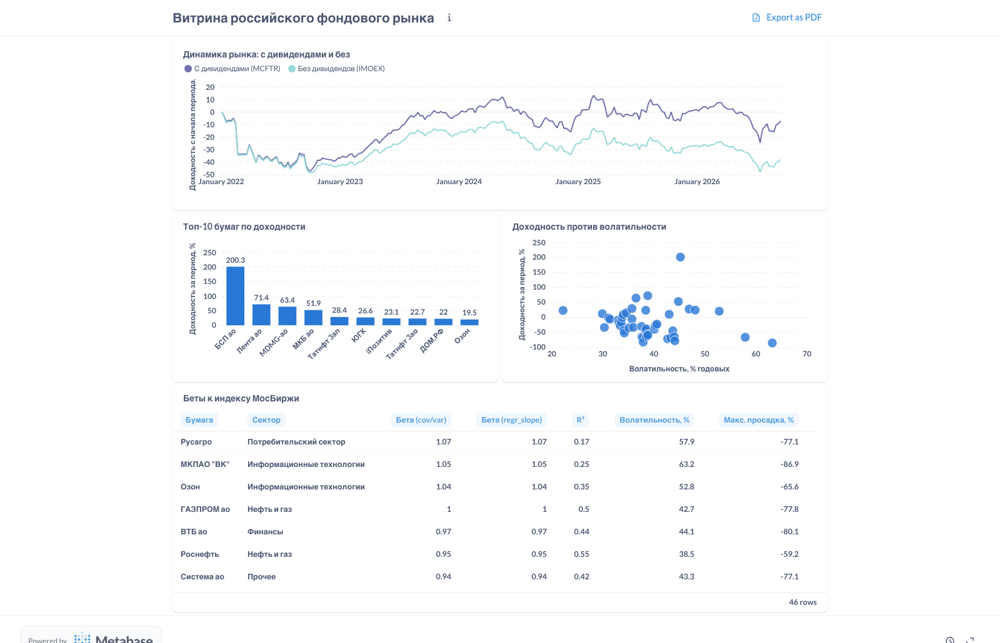

# Витрина аналитики российского фондового рынка

Аналитическая витрина по данным Московской биржи за 2022–2026 годы, в которой
**все расчёты выполняются в SQL**, а Python используется только для загрузки
данных из API в базу.

---

## Как запустить

Нужны Docker и Python 3.11+.

```bash
cp .env.example .env && make up      # поднять PostgreSQL 16 и Metabase
make etl                              # загрузить данные MOEX ISS (~5 минут)
make dashboard                        # собрать дашборд в Metabase
```

Дальше: дашборд на `http://localhost:3000/dashboard/2`, вход
`analyst@moex.local` / `REDACTED`.

Учётные данные — дефолты локального стенда: и PostgreSQL, и Metabase
поднимаются в контейнерах на `localhost` и наружу не смотрят. Свои значения
задаются через переменные окружения: `POSTGRES_PASSWORD` в `.env` для базы,
`MB_PASSWORD` для Metabase.

Остальные команды: `make checks` — проверки качества данных, `make psql` —
консоль базы, `make refresh` — повторная загрузка с обновлением пересчитанных
биржей строк, `make clean` — снести всё вместе с данными.

---

## Дашборд



---

## Данные и слои

Источник — открытый ISS API Московской биржи, без ключа и регистрации.
Периметр: **46 бумаг индекса МосБиржи**, 2022-01-03 … 2026-09-14,
**47 672 строки** котировок, 2 351 строка по индексам. Размер базы 57 МБ.

```
staging  →  core  →  marts
```

**`staging`** — сырые ответы API, все колонки `text`, без ограничений и без
первичных ключей. Append-only: каждый прогон дописывает новый батч с
`_batch_id`, `_loaded_at` и `_source_url`. Это журнал того, что отдал
источник, а не копия `core`.

**`core`** — очищенные типизированные данные с ограничениями целостности:

| Таблица | Содержание |
|---|---|
| `quote` | дневные котировки акций, PK `(secid, trade_date)` |
| `index_quote` | история IMOEX и MCFTR |
| `security` | справочник бумаг TQBR |
| `security_sector` | сектор бумаги, PK на `secid` |
| `index_weight` | веса бумаг в индексе |
| `split` | дробления акций |
| `trading_day` | представление: эталонный торговый календарь |

**`marts`** — витрины: `mv_daily_return` (доходности по скорректированным
ценам), `mv_index_return`, `mv_security_stats` (доходность, волатильность,
бета, просадка, ликвидность на бумагу), `v_cumulative_return`.

Смысл разделения — не в эстетике. При неверной цифре на дашборде сразу видно,
где искать: если она уже битая в `staging` — виноват источник; если в
`staging` верная, а в `core` нет — виноват перелив; если в `core` верная —
виновата логика витрины.

---

## Находки

### 1. Дивиденды — не бонус, а половина результата

Индекс МосБиржи за 4 года и 8 месяцев потерял **−38.7%**. Тот же портфель с
реинвестированием дивидендов (индекс MCFTR) — только **−8.6%**.

Чистый вклад дивидендов: **+49.1%** за период, от 6.9% до 15.7% годовых:

| Год | Без дивидендов | С дивидендами | Вклад дивидендов |
|---|---|---|---|
| 2022 | −46.7% | −38.3% | +15.7% |
| 2023 | +43.9% | +53.8% | +6.9% |
| 2024 | −7.0% | +1.6% | +9.3% |
| 2025 | −4.0% | +2.9% | +7.3% |
| 2026 | −14.7% | −7.9% | +7.9% |

Обратите внимание на 2024 и 2025: **без дивидендов рынок в минусе, с ними —
в плюсе**. Инвестор, смотревший только на график индекса, оба года считал
убыточными, хотя они были прибыльными.

Важная деталь методики: вклад дивидендов — это **отношение**
`(1+r_полн)/(1+r_цен) − 1`, а не разность процентов. Разность дала бы 30.1 п.п.
вместо правильных 49.1% — ошибка в 19 пунктов на ровном месте.

### 2. Высокая бета одинаково усиливает и рост, и падение

Разделив 39 бумаг с полной историей на три группы по бете:

| Группа | Средняя бета | Рост 2023 | Падение 2026 | Макс. просадка | Волатильность |
|---|---|---|---|---|---|
| Низкая бета | 0.63 | **+40.4%** | **−7.5%** | −57.8% | 37.9% |
| Средняя | 0.79 | +58.7% | −21.0% | −64.9% | 38.1% |
| Высокая бета | 0.94 | **+64.6%** | **−21.1%** | −67.5% | 43.3% |

Закономерность держится на всех четырёх метриках сразу. В год роста высокая
бета дала на 24 процентных пункта больше, в год падения — потеряла втрое
больше, и просадка глубже на 10 пунктов. Бета работает симметрично: это
множитель риска, а не признак хорошей бумаги.

Отдельно стоит отметить: **ни одна бумага индекса не имеет бету выше 1.07**.
Причина в устройстве самого индекса — он взвешен по капитализации, и на
Лукойл с Газпромом приходится 27% веса. Крупные бумаги фактически и есть
индекс, поэтому их бета близка к единице по построению.

### 3. Биржа не корректирует цены на дробления, и это ломает всё

MOEX отдаёт цены такими, какими они были в тот день. За период пять бумаг
индекса прошли дробление, и без поправки цифры выглядят так:

| Бумага | Без корректировки | После корректировки |
|---|---|---|
| ГМК Норникель | −99.4% | −44.3% |
| Транснефть ап | −99.4% | −35.4% |
| Полюс | −92.3% | −23.4% |
| ВТБ | **+105 845%** | −78.8% |

Норникель не терял 99% капитализации, а ВТБ не вырастал в тысячу раз. Без
поправки эти пять бумаг заняли бы весь топ и весь антитоп любого рейтинга,
а вместе с ними поехали бы волатильность, бета и просадка.

Дробления пришлось выводить из самих котировок (открытый API корпоративные
действия больше не отдаёт) по порогу «цена изменилась более чем вдвое».
Порог оказался чистым: ближайшее к нему настоящее движение — +72% у ВК в
марте 2022, ложных срабатываний нет. **Независимое подтверждение:** у всех
пяти бумаг последний пропуск торгов приходится ровно на день перед
найденной датой — биржа останавливала торги на конвертацию.

### 4. Месяц, которого нет в данных

С **26 февраля по 23 марта 2022 года биржа не работала 18 торговых дней
подряд**. Найдено приёмом «островов и промежутков»: `generate_series` даёт
полный календарь, а разность `дата − row_number()` остаётся постоянной внутри
непрерывного интервала.

Это не аномалия загрузки, а реальное событие, и его важно видеть: любой
расчёт на дневных доходностях в этот период имеет разрыв, а первый день после
открытия несёт в себе накопленное движение почти за месяц.

### 5. Сумма доходностей даёт физически невозможные числа

Накопленная доходность — произведение `(1+r)`, а не сумма `r`. На реальных
данных ошибка не косметическая:

| Бумага | Правильно | Через сумму | Расхождение |
|---|---|---|---|
| АЛРОСА | −83.4% | **−145.9%** | 62.5 п.п. |
| ОЗОН | +20.5% | +81.6% | 61.0 п.п. |
| Сбербанк | −5.9% | +26.1% | 32.0 п.п. |

У АЛРОСА сумма даёт −145.9%. Акция не может подешеветь больше чем на 100% —
число само выдаёт неверный метод. У Сбербанка ошибка коварнее: меняется знак,
убыточная бумага выглядит прибыльной.

---

## Технические решения

### Первичный ключ уже создаёт индекс

ТЗ требовало индекс на `(secid, trade_date)`. Он есть, но создавать его руками
не нужно — `PRIMARY KEY (secid, trade_date)` строит его сам:

```
Indexes:
    "quote_pk" PRIMARY KEY, btree (secid, trade_date)
    "quote_date_secid_idx" btree (trade_date, secid)
```

Второй такой же индекс стоил бы 1472 КБ впустую и замедлял каждую вставку.
Создан индекс с **обратным порядком колонок**: составной индекс работает слева
направо, и по `(secid, trade_date)` нельзя ответить на вопрос «все бумаги за
3 марта» — ведущая колонка не задана. А именно такие запросы у нас основные:
расчёт беты — это соединение котировок с историей индекса по дате.

### Замеры EXPLAIN (ANALYZE, BUFFERS)

Запрос «срез рынка на дату», среднее из 5 прогонов:

| | Без индекса | С индексом |
|---|---|---|
| План | `Index Scan using quote_pk` | `Bitmap Index Scan on quote_date_secid_idx` |
| Buffers | 229 | 48 |
| Время | 1.350 мс | **0.473 мс** |

Тяжёлый запрос (беты всех бумаг: оконная функция, соединение, агрегаты):

| | Без индекса | С индексом |
|---|---|---|
| Время | 67.53 мс | 67.96 мс |

**Индекс не дал ничего — и это самый поучительный результат.** План в обоих
случаях одинаков: планировщик выбрал `quote_pk`. Оконной функции
`lag() OVER (PARTITION BY secid ORDER BY trade_date)` нужны строки,
отсортированные по `(secid, trade_date)`, и первичный ключ отдаёт их в готовом
порядке. Сэкономить на сортировке 47 тысяч строк оказалось выгоднее, чем
выиграть на фильтре по дате.

Вывод: индекс ускоряет не «запрос вообще», а конкретный способ доступа.
Прежде чем добавлять индекс, надо посмотреть `EXPLAIN` и убедиться, что
планировщик собирается им пользоваться.

### VIEW против MATERIALIZED VIEW

**VIEW** — сохранённый текст запроса: выполняется заново при каждом обращении,
места не занимает, данные всегда свежие. **MATERIALIZED VIEW** — таблица с
результатом: читается быстро, можно строить индексы, но данные заморожены до
`REFRESH`.

В проекте материализованы `mv_daily_return`, `mv_index_return`,
`mv_security_stats` — там оконные функции по 47 тысячам строк, а результат
меняется раз в сутки после загрузки. Обычными оставлены `trading_day` и
`v_cumulative_return` — они лёгкие и должны показывать свежие данные.

Цена решения: забыть `REFRESH` — значит показать вчерашние цифры без всякого
предупреждения. Поэтому `marts.refresh_all()` вызывается в конце ETL, а не
руками. `REFRESH ... CONCURRENTLY` не блокирует чтение, но требует уникального
индекса на представлении.

### numeric, а не float

Для `double precision` `0.1 + 0.2 ≠ 0.3`. На 47 тысячах строк накопленной
доходности через произведение ошибка вылезает в третьем знаке — ровно тот
случай, когда цифра в отчёте не сходится с цифрой в бэктесте, и никто не
понимает почему.

### Идемпотентность ETL

Повторный запуск не создаёт дублей: первичный ключ `(secid, trade_date)` плюс
`ON CONFLICT DO NOTHING`. **Проверено полным прогоном:** второй запуск получил
те же 48 538 строк и записал в `core` ровно **0**.

При этом `staging` вырос с 48 538 до 97 076 строк — так и задумано. Append-only
позволяет сравнить, что источник отдавал в разные дни, и поймать
ретроспективный пересчёт итогов торгов (проверка 5 в `make checks`).

Обратная сторона: `DO NOTHING` означает, что исправления биржи в `core` не
попадут. Для этого есть `make refresh` — режим `DO UPDATE`, обновляющий только
реально изменившиеся строки.

### Сектора выведены из данных, а не размечены руками

Поле `SECTORID` в API есть, но у всех 506 бумаг TQBR равно `NULL` — оно
мёртвое. Сектор берётся из состава десяти отраслевых индексов MOEX: если
бумага входит в `MOEXOG`, её сектор — нефть и газ. Источник тот же, что и у
котировок, — сама биржа.

Первичный ключ в `security_sector` стоит на **одном** `secid`, а не на паре.
Проверено: 45 из 46 бумаг входят ровно в один отраслевой индекс. Ключ
превращает наблюдение в гарантию — если биржа запишет бумагу в два сектора,
ETL упадёт. Альтернатива «многие ко многим» тихо удвоила бы бумагу в рейтинге
и сдвинула границы квартилей `NTILE` у всех бумаг сектора. Громкая ошибка
лучше тихо неверной витрины.

---

## Ограничения проекта

1. **Дивиденды по отдельным бумагам недоступны.** Эндпоинт
   `/iss/securities/{SECID}/dividends.json` отвечает HTTP 200, но блока
   `dividends` в ответе больше нет. Корпоративные действия переехали в
   `/iss/cci/corp-actions/dividends`, который отвечает: «Информация доступна
   только подписчикам». Поэтому вклад дивидендов считается на уровне рынка —
   по паре индексов IMOEX и MCFTR. Это официальные данные биржи, но разложить
   их по бумагам нельзя.

2. **Дробления акций выведены эвристикой, а не получены из источника.** Порог
   «цена изменилась более чем вдвое» на этих данных работает точно и
   подтверждается остановками торгов, но это всё же вывод из котировок.
   Коэффициент округляется до стандартной пропорции (105.37 → 100); остаток
   считается реальным движением цены и остаётся в доходности.

3. **Ошибка выжившего.** Состав индекса взят на **сегодняшнюю** дату, а
   история грузится за 4.7 года назад. Бумаги, исключённые из индекса за это
   время, в выборку не попали. Реальная доходность «портфеля индекса» была
   ниже той, что даёт эта выборка: выбывают обычно худшие. Корректно было бы
   брать исторический состав на каждую дату — эндпоинт это позволяет, но
   потребовал бы отдельной таблицы состава по датам.

4. **46 бумаг — не весь рынок.** За периметром 460 бумаг TQBR, в том числе
   весь третий эшелон, где ликвидность и волатильность устроены иначе.

5. **Волатильность и бета считаются по всему периоду сразу.** В 2022 году
   рынок вёл себя принципиально иначе, чем в 2025-м; усреднение по всему
   отрезку скрывает эту разницу. Скользящие оценки есть только для
   волатильности (запрос 02), для беты — нет.

6. **Дневные данные.** Внутридневной риск, проскальзывание и стаканы не
   рассматриваются — для них нужны другие эндпоинты и другой объём данных.

---

## Структура репозитория

```
sql/
├── schema/      DDL трёх слоёв, применяется автоматически при первом старте
├── etl/         перелив staging → core (SQL, а не Python)
├── queries/     восемь аналитических запросов, по файлу на вопрос
├── checks/      пять проверок качества данных
└── performance/ запросы для замеров EXPLAIN
etl/             клиент ISS API, оркестратор загрузки, проверки качества
scripts/         сборка дашборда в Metabase через API
docs/            скриншот дашборда
```

Аналитические запросы:

| Файл | Вопрос |
|---|---|
| `01_returns.sql` | дневная и накопленная доходность |
| `02_volatility.sql` | скользящая волатильность за 30 дней |
| `03_drawdown.sql` | максимальная просадка |
| `04_beta.sql` | бета двумя способами |
| `05_sector_rank.sql` | рейтинги внутри секторов |
| `06_liquidity.sql` | медиана и квартили оборота |
| `07_calendar.sql` | торговый календарь и пропуски |
| `08_dividends_mcftr.sql` | доходность с дивидендами против чистой |
